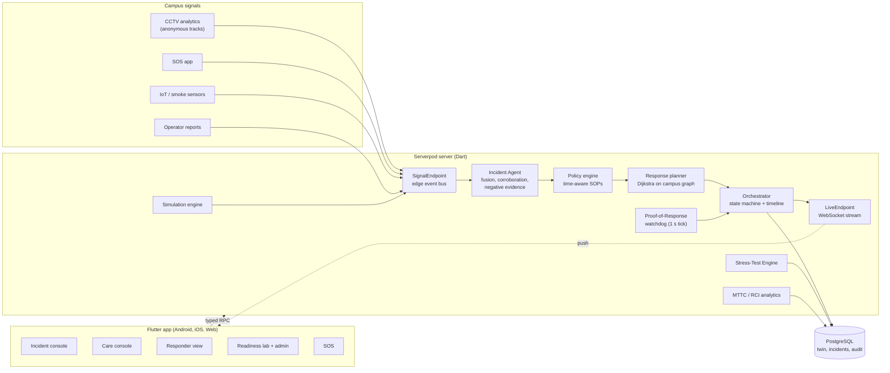
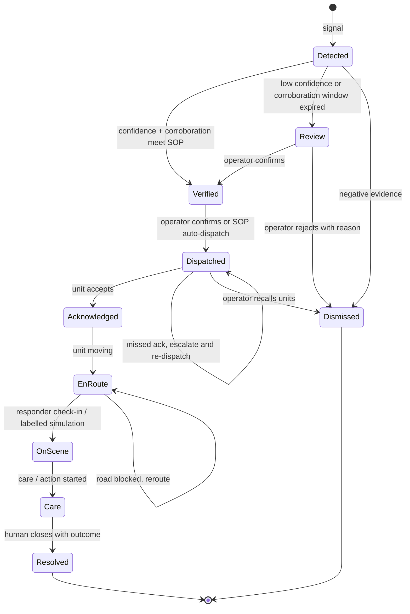
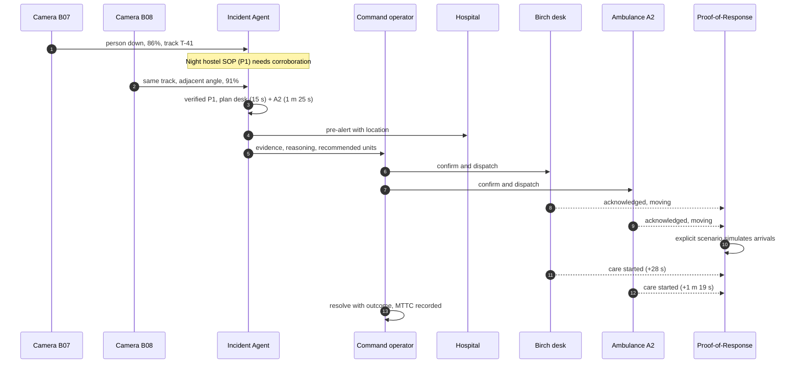
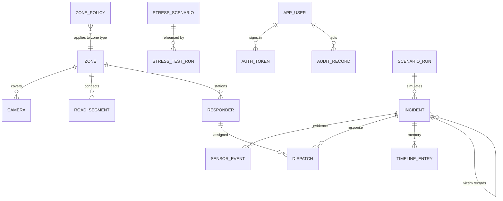

<div align="center">

# CareGrid

> **Startup Buildathon India 2026 · Team Duality (Hriday Vig + Ishaan Sharma).** Start with the [submission package](docs/buildathon/README.md), [Google solution architecture](docs/buildathon/SOLUTION-ARCHITECTURE.md), and [interactive web prototype](caregrid_web/README.md). [Pitch assets](assets/pitch/README.md) include the architecture graphic and product captures. The older Flutter/Serverpod documentation below describes the inherited prototype; Serverpod Cloud is a historical deployment path. The proposed event architecture uses Google Cloud. No live Google resources or campus pilot are claimed.

> **20 November update:** the [connected web MVP](docs/buildathon/CONNECTED-MVP.md) now runs member SOS, command dispatch, responder proof, care handoff, readiness and analytics against the actual Serverpod/PostgreSQL backend. Start on Windows with `powershell -File scripts/start-local.ps1` from this repository. [Connected product screenshots](assets/pitch/connected/README.md). Verification: 73 backend tests, 26 Node checks and six Chrome tests (three real workflows, a delayed-draft UI race, a private-storage UI fixture and a Google-entry configuration preview); backend static analysis clean. [Google runtime and identity](docs/buildathon/GOOGLE-RUNTIME.md) are implemented for deployment verification once a project exists.

**The AI emergency response operating system for campuses**

*No emergency should wait in a queue, and no response should be trusted merely because an alert was sent.*

[](https://flutter.dev)
[](https://dart.dev)
[](https://serverpod.dev)
[](docs/buildathon/SOLUTION-ARCHITECTURE.md)
[](https://www.postgresql.org)
[](#run-it-locally)
[](#tests)

</div>

CareGrid turns normalized campus signals (camera analytics fixtures, member SOS, IoT, vehicle and access events) into **owned, verified incidents**, applies **site-specific policy**, recommends **available human responders**, and records acknowledgement, departure, arrival, care start and human closure. Every stage is timed, so the campus measures **Mean Time To Care (MTTC)**. Current non-simulation arrival is an authenticated responder check-in; scenario travel is explicitly simulated.

This repository is a local MVP with seeded fictional data: a **Flutter + Serverpod** application plus the connected editorial web workspace, deterministic incident policy, Proof-of-Response watchdog, compound-failure stress engine and simulation lab. The historical Serverpod Cloud deployment path is retained as manual reference; the buildathon target is Google Cloud.

> Every component, screen, endpoint, model and seeded record is documented in **[docs/COMPONENTS.md](docs/COMPONENTS.md)**.

---

## Contents

- [The problem](#the-problem)
- [What CareGrid does](#what-caregrid-does)
- [Architecture](#architecture)
- [Incident lifecycle](#incident-lifecycle)
- [The 02:17 hero scenario](#the-0217-hero-scenario)
- [Data model](#data-model)
- [Roles and consoles](#roles-and-consoles)
- [Seeded demo](#seeded-demo)
- [Run it locally](#run-it-locally)
- [Deploy to Serverpod Cloud](#deploy-to-serverpod-cloud)
- [Tests](#tests)
- [Project structure](#project-structure)
- [Privacy, safety and governance](#privacy-safety-and-governance)
- [Roadmap](#roadmap)
- [Keywords](#keywords)

## The problem

On a large campus, an emergency becomes care only at the end of a manual relay: *event, someone notices, location is understood, the right responder is found, transport is available, the responder reaches the person, clinical handoff*. Each handoff loses minutes and context. Meanwhile, traditional monitoring puts benign activity and real emergencies in the same alarm queue, and "alert sent" is counted as success even when nobody arrives.

## What CareGrid does

| Loop stage | What happens | Where in the code |
| --- | --- | --- |
| **Sense** | Camera inference, SOS, IoT, access and vehicle signals enter one edge event bus. | `SignalEndpoint`, `SosEndpoint` |
| **Understand** | The Incident Agent fuses signals, corroborates across adjacent cameras or sensors, looks for **negative evidence** and links multiple victims to one incident. | `IncidentAgent` |
| **Decide** | Time-aware zone policies (SOPs) set severity, verification thresholds, required responders and SLAs. | `PolicyEngine`, `ZonePolicy` |
| **Act** | The planner routes every available unit over the campus graph (closed gates, blocked roads) and recommends the fastest response; the operator confirms, or life-safety SOPs auto-dispatch. | `ResponsePlanner`, `CampusGraph`, `Orchestrator` |
| **Verify** | **Proof-of-Response** tracks each unit against an expected trajectory: missed acknowledgement or a stall escalates and re-dispatches, never closes. | `ProofOfResponse` |
| **Close** | Only a human resolves an incident, after arrival and care/action are recorded. Closure cannot create a care timestamp. | `IncidentEndpoint.resolve` |
| **Learn** | Stage-by-stage MTTC, Response Completion Integrity (RCI), false escalations, blind spots; plus the **Stress-Test Engine** that rehearses compound failures and proposes fixes. | `MetricsService`, `StressTestEngine` |

Two capabilities extend the loop beyond dispatch:

- **Proof-of-Response**: `DISPATCHED > ACKNOWLEDGED > MOVING > ON SCENE > CARE > RESOLVED`, with recorded milestones and deadlines. Travel-time simulation is restricted to explicit scenario runs; genuine cases require authenticated responder check-in.
- **Stress-Test Engine**: rehearses an emergency plus things going wrong at once (ambulance busy, gate closed, camera degraded) on a private copy of the digital twin, predicts every stage, and finds fixes such as *alternate route via a service gate* or *re-stage an alternate responder*. Fixes can be applied to the live twin with one click.

## Architecture



### Stack and why

| Layer | Choice | Why it fits |
| --- | --- | --- |
| App | **Flutter 3.47** (Material 3) | One codebase for Android, iOS and the web console; responders and members are mobile-first. |
| Backend | **Serverpod 4** (Dart) | Typed endpoints and models shared with the app, built-in WebSocket streaming, ORM and migrations, first-class Flutter client. |
| Realtime | Serverpod streaming methods + message channels | Every state change pushes an event; clients refetch role-filtered data. |
| Database | PostgreSQL embedded locally; **Cloud SQL target** | Google staging infrastructure is prepared. Migrations run in a private maintenance job before serving a revision. |
| Hosting | **Google Cloud Run target** | Separate web gateway, API and watchdog; [phased deployment configuration](infra/google/README.md). The Serverpod Cloud section below is historical/manual. |
| Map | Schematic digital twin drawn with `CustomPaint` | No tiles or API keys; positions come from the twin. |

## Incident lifecycle



Every open incident always has a **next action** and a **next deadline**. When a deadline passes, Proof-of-Response escalates (and re-plans where it can). Nothing is closed because time passed.

## The 02:17 hero scenario

A resident collapses in a hostel corridor at night. Nobody is around to call for help.



The timings above are from a real autopilot run of this prototype. If Ambulance A2 never acknowledges (scenario `SC-MISSED-ACK`), Proof-of-Response marks it unreachable after the 30 s SLA, escalates and re-dispatches Ambulance A1.

## Data model



15 database tables, 22 transfer/view models, 16 enums and one typed exception. Full field lists: [docs/COMPONENTS.md](docs/COMPONENTS.md#5-data-models).

## Roles and consoles

| Role | Console | Can do |
| --- | --- | --- |
| **Security / Command** | Incidents, Live map, Twin, Simulation, Analytics | See every incident with evidence; confirm or override dispatch; escalate; dismiss with reason; resolve; run scenarios; manage units, gates and roads. |
| **Medical team** | Care console, Live map | Incoming cases with location, ETA and handoff state; mark the hospital ready; care notes; resolve. No camera evidence. |
| **Responder** | My task, Map | One task with minimum context, route and SOP steps; acknowledge, start moving, arrive, start care, complete or decline. |
| **IT / Administration** | Readiness, Twin, Policies, Analytics, Audit | Stress tests and fixes; SOP thresholds and SLAs; camera health; audit log; demo reset. |
| **Campus member** | SOS | Raise an SOS for self or others; follow its status and ETA; cancel. Sees nothing about anyone else. |

## Seeded demo

The fictional **Meridian Demo Campus** is seeded on first boot: 26 zones (4 hostels, hospital, labs, library, commons, sports, gates, junctions), 34 road segments, 19 cameras (one offline to create a blind spot), 11 response units, 11 SOPs, 4 stress rehearsals and 14 past incidents for analytics.

**Accounts** (handle / PIN)

| Role | Handle | PIN |
| --- | --- | --- |
| Command operator | `cmd.night` | `1111` |
| Doctor on duty | `er.doctor` | `2222` |
| Ambulance A2 crew | `amb.a2` | `3302` |
| Birch Hostel desk | `desk.birch` | `3303` |
| Ambulance A1 crew | `amb.a1` | `3301` |
| Patrol Bike 1 | `patrol.one` | `3304` |
| Fire & safety lead | `fire.one` | `3305` |
| Operations admin | `ops.admin` | `9090` |
| Student (member) | `student.aanya` | `5501` |
| Library staff (member) | `staff.rohan` | `5502` |

**Live scenarios** (Simulation tab, with or without autopilot)

| Code | What it shows |
| --- | --- |
| `SC-HOSTEL-0217` | Two-camera corroboration, night SOP, hospital pre-alert, full Proof-of-Response |
| `SC-SPORTS-RECOVER` | Negative evidence dismisses a fall; nobody is dispatched |
| `SC-LAB-SMOKE` | Camera + smoke detector fusion, P0 auto-dispatch |
| `SC-SOS-LIBRARY` | SOS as a human witness |
| `SC-EASTGATE-COLLISION` | Collision plus injured rider fused into one incident |
| `SC-CROWD-VICTIMS` | Crowd surge with two victims linked to one parent incident |
| `SC-MISSED-ACK` | Missed acknowledgement, escalation, re-dispatch |
| `SC-CEDAR-BLIND` | SOS from a camera blind spot, reported transparently |

**Stress rehearsals** (Readiness tab): the 02:17 compound failure predicts 6 m 41 s against a 5 m SLA (**FAIL**), and the engine finds two fixes that each pass on their own (alternate route through the North-West Service Gate: 4 m 12 s). Applying the lab and hostel fixes raises campus readiness from 50% to 100%.

> Demo tip: open two windows, sign in as `cmd.night` and `amb.a2`, turn autopilot off, run `SC-HOSTEL-0217`, and drive the incident by hand from both sides.

## Run it locally

**Prerequisites:** Flutter 3.44.4 or newer (Dart 3.12.2+) and the Serverpod CLI:

```bash
dart install serverpod_cli
```

**1. Local secrets.** `caregrid_server/config/passwords.yaml` is git-ignored. Create it with any values:

```yaml
development:
  database: 'local-dev-db-password'
  serviceSecret: 'local-dev-service-secret-min-20-chars'
test:
  database: 'local-test-db-password'
```

**2. Start everything** from the repository root. Serverpod runs an embedded PostgreSQL (no Docker), applies migrations, seeds the campus and launches the app:

```bash
flutter pub get
serverpod start
```

Or run the pieces by hand:

```bash
cd caregrid_server && dart run bin/main.dart --apply-migrations   # API :8080, web :8082
cd caregrid_flutter && flutter run -d chrome                       # or an Android/iOS device
```

**3. Phones.** The Android emulator reaches your machine automatically. For a physical device pass your computer's LAN IP:

```bash
flutter run --dart-define=SERVER_URL=http://192.168.1.20:8080/
```

To serve the web build from the server itself (as Serverpod Cloud does), run `serverpod run flutter_build` in `caregrid_server`, then open <http://localhost:8082>.

## Deploy to Serverpod Cloud

The server hosts both the API and the Flutter web app, and Cloud provisions PostgreSQL and runs migrations on every deploy.

```bash
serverpod cloud auth login     # once, opens the browser
serverpod cloud launch         # first deploy: creates/links the project, writes scloud.yaml
serverpod cloud deploy         # every later deploy
```

`launch` adds `serverpod generate` and `serverpod run flutter_build` as pre-deploy hooks, so each deploy ships the latest web build. The app is then live at `https://<project-id>.serverpod.space/` with the API at `https://<project-id>.api.serverpod.space/`. Mobile builds point at the cloud API with `--dart-define=SERVER_URL=https://<project-id>.api.serverpod.space/`.

**Continuous deployment:** `.github/workflows/deploy.yml` deploys every push to `main` once the repository has a `SERVERPOD_CLOUD_TOKEN` secret (create one with `serverpod cloud auth create-token`) and `scloud.yaml` is committed.

## Tests

```bash
cd caregrid_server && dart test
```

73 backend tests cover routing/policy/planning/rehearsal, the full response loop, closure/arrival guards, role/assignment/redaction boundaries, production demo denial, concurrent watchdog ownership, Firebase RSA validation and SQL membership/revocation. The web package adds 26 Node checks and six isolated Chrome tests (three real local workflows, a delayed-draft UI race, a private-storage UI fixture and a Google-entry configuration preview). Linux CI builds both images and verifies non-superuser migrations/bootstrap; Terraform schema validation and ten mocked rollout plans check the staging deployment. [Current validation and limits](docs/buildathon/VALIDATION.md). The [optional Gemini handoff adapter](docs/buildathon/GOOGLE-GEMINI.md) is implemented with synthetic response tests and remains disabled by default. No real Gemini/OAuth, Cloud Build or cloud deployment has run.

## Project structure

```text
CareGrid/
├── caregrid_server/            Serverpod backend
│   ├── lib/server.dart         Boot: auth handler, seeding, ops ticker
│   ├── lib/src/models/         .spy.yaml models (enums, twin, incidents, response, readiness, views)
│   ├── lib/src/agent/          Incident Agent + policy engine
│   ├── lib/src/response/       Planner, orchestrator, Proof-of-Response, role views
│   ├── lib/src/readiness/      Stress-Test Engine
│   ├── lib/src/simulation/     Scenario library + simulation engine
│   ├── lib/src/twin/           Twin snapshot + campus graph (Dijkstra)
│   ├── lib/src/endpoints/      12 API endpoints
│   ├── lib/src/seed/           Seeded campus and history
│   ├── migrations/             Database migrations
│   └── test/                   Unit + integration tests
├── caregrid_client/            Generated typed client (do not edit)
├── caregrid_flutter/           Flutter app (Android, iOS, Web)
│   └── lib/src/
│       ├── core/               Session, live feed, formatting, actions
│       ├── widgets/            Shared components (map, trackers, tiles...)
│       └── features/           Screens per role
└── docs/COMPONENTS.md          Single reference for every component
```

## Privacy, safety and governance

- **No facial recognition.** Cameras emit anonymous track events; identity is never inferred.
- **Least privilege on the server.** Each role receives a redacted view; the response lists what was hidden and why.
- **Audit everything.** Sign-ins, incident views, dispatches, overrides, dismissals, fixes and resets are logged.
- **Human override.** Operators can reject, choose different units, escalate or recall; every override is recorded.
- **Clinical boundary.** CareGrid reports observable events and consequences ("potential medical emergency"), never a diagnosis.
- **Autonomy boundary.** Triage and coordination can be automatic; closure is always human and requires verified arrival.
- **Transparent uncertainty.** Degraded coverage and blind spots are shown, not hidden.

## Roadmap

| Phase | Scope |
| --- | --- |
| Now | Prototype on a seeded campus twin (this repository) |
| Next | Real edge inference (person-down, fall, smoke) publishing to `SignalEndpoint` |
| Then | Campus SSO, live hospital and ambulance integrations, push notifications |
| Later | Multi-campus control plane, district hubs, rural PHC and telemedicine spokes |

Metrics shown in the app are measured on the prototype and seeded data. They are targets until measured in a pilot.

## Keywords

`emergency-response` `incident-management` `healthcare` `campus-safety` `flutter` `dart` `serverpod` `serverpod-cloud` `postgresql` `real-time` `websockets` `digital-twin` `dispatch` `computer-vision` `ai-agents` `mttc` `proof-of-response` `stress-testing` `sos` `telemedicine` `smart-campus` `public-safety` `mobile-app`

## Team

Team Duality: Ishaan Sharma, Hriday Vig. Older PDFs/design exports may retain previous event/team names as historical source material.
