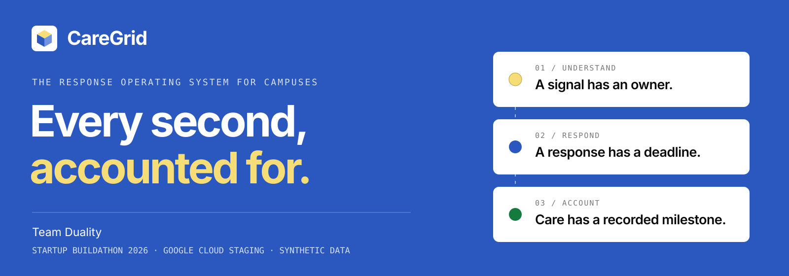
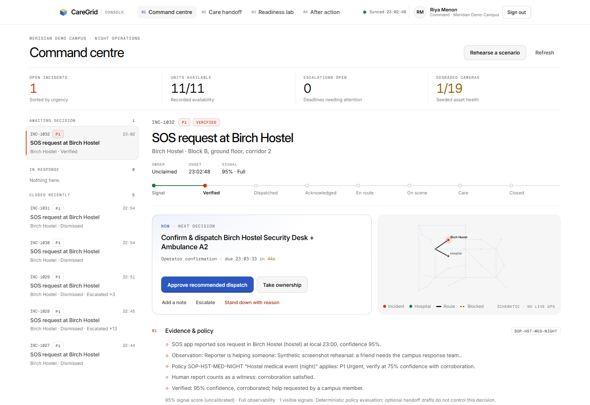
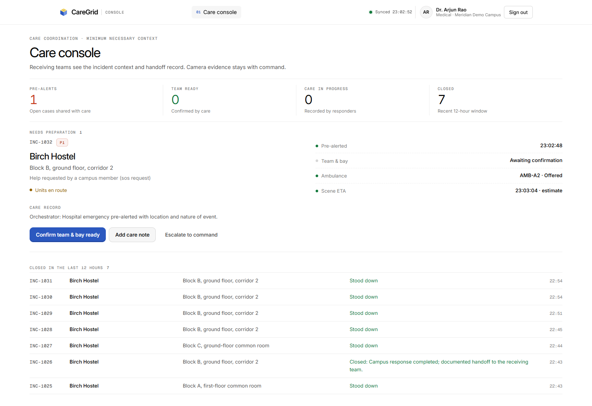
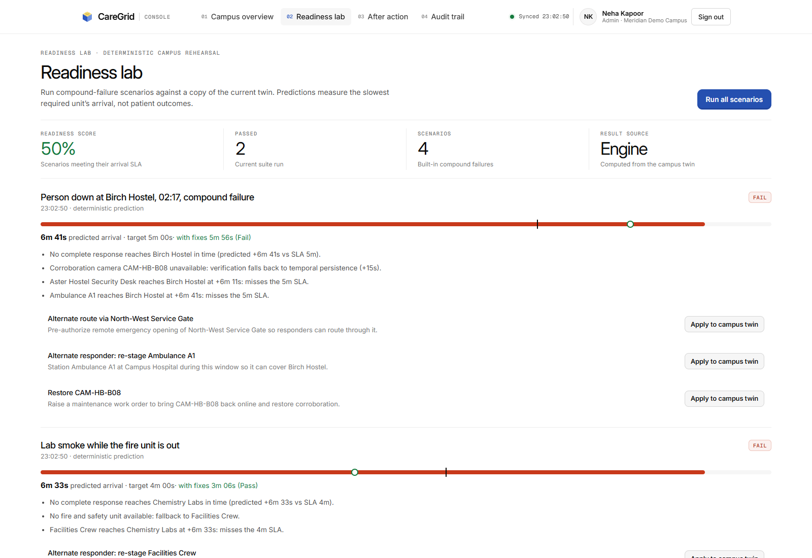
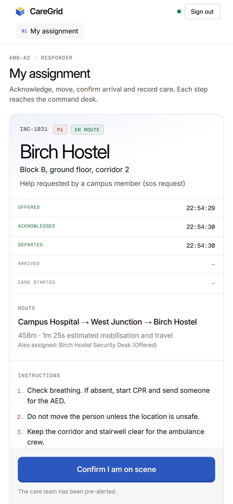
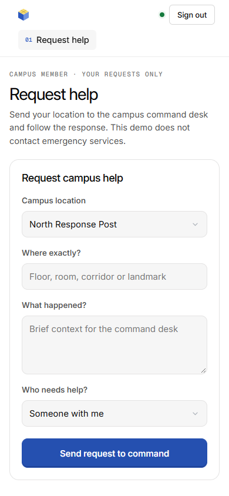
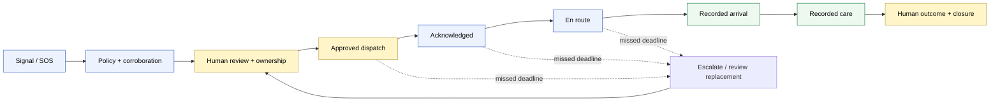
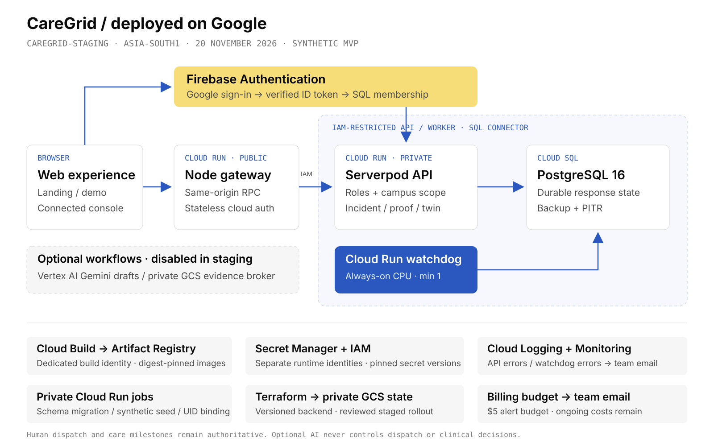
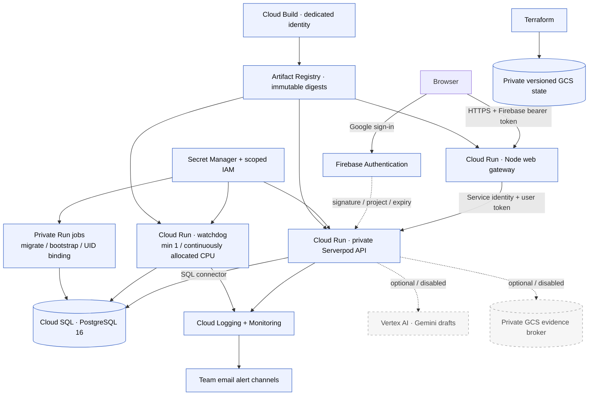
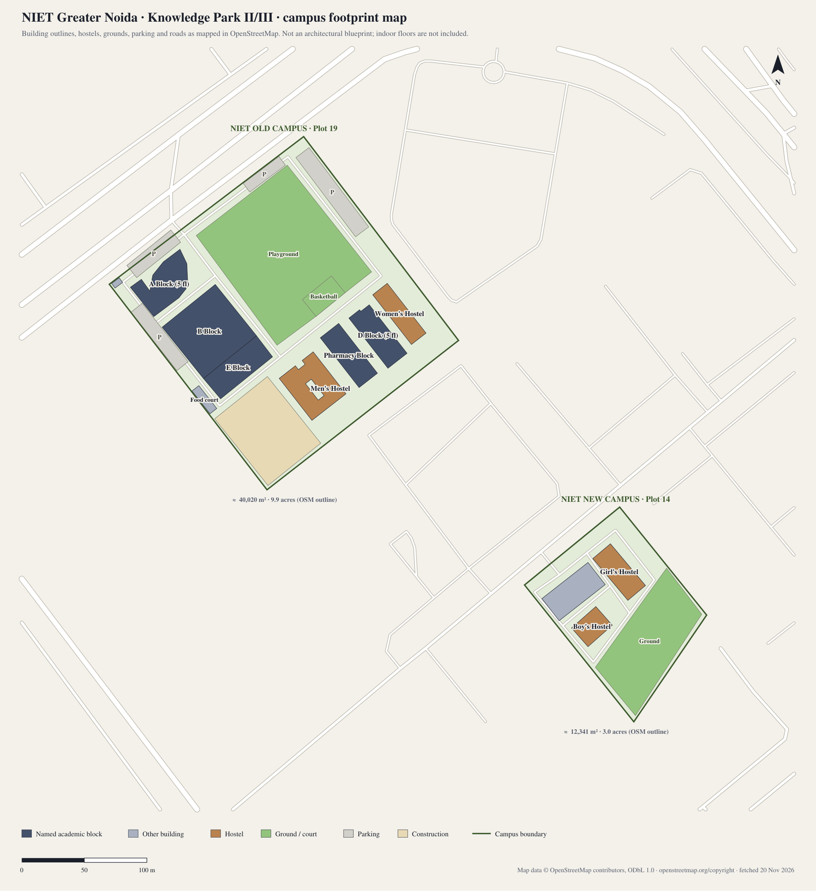

<div align="center">

[](https://caregrid-demo-web-959096744456.asia-south1.run.app/)

**The response operating system for campuses.**

[Explore the website ↗](https://caregrid-demo-web-959096744456.asia-south1.run.app/) · [Enter the console ↗](https://caregrid-demo-web-959096744456.asia-south1.run.app/console) · [Try the presentation ↗](https://caregrid-demo-web-959096744456.asia-south1.run.app/demo)

[**Watch the 2:00 product demo ↗**](output/video/CareGrid-Team-Duality.mp4) · [Video, captions and editable project](output/video/README.md)

[](https://github.com/ishaans04/CareGrid/actions/workflows/web-prototype.yml)
[](https://github.com/ishaans04/CareGrid/actions/workflows/google-runtime.yml)
[](https://github.com/ishaans04/CareGrid/actions/workflows/google-infrastructure.yml)

Built by **[Hriday Vig](https://github.com/vighriday) + [Ishaan Sharma](https://github.com/ishaans04)** · **Team Duality** · [Startup Buildathon](https://startupbuildathon.com/)

[Product](#the-product) · [Response loop](#a-response-that-can-be-accounted-for) · [Google architecture](#built-on-google) · [Campus twin](#a-campus-you-can-rehearse) · [Run locally](#run-the-connected-mvp) · [Pitch assets](#take-it-into-the-deck)

</div>

---

A camera flags a person down. A student raises an SOS. A smoke sensor trips. The difficult part follows: deciding who owns the incident, who is actually responding, whether they arrived, and when care began.

CareGrid keeps that response in one shared record. Command reviews the signal and approves dispatch. Responders record their milestones. The receiving team prepares for the handoff. A watchdog escalates missed deadlines. The readiness lab lets operators rehearse failures before the next incident.

> **Working staging MVP · fictional campus data.** The Google deployment is live. Product screenshots use the finalized UI with a real local Serverpod/PostgreSQL backend. [Acceptance boundaries](#what-is-live-and-what-is-next) distinguish the implemented, deployed and still-unverified paths.

## The product

[](assets/pitch/launch/02-command-centre.png)

**One case. One next decision. A visible response chain.** Command brings the queue, campus context, recommended units, proof milestones and evidence into a focused flow. Click any product image to inspect the full export.

| Command and care share the record | Operations rehearses the next failure |
| :--- | :--- |
| [](assets/pitch/launch/08-care-handoff.png) | [](assets/pitch/launch/04-readiness-lab.png) |
| Receiving-team readiness and the incoming response, with role-limited context. | Compound failures, predicted arrival against the SLA, findings and proposed changes to the twin. |

<p align="center">
  <a href="assets/pitch/launch/deck/02-ambulance-crew.png"></a>
  &nbsp;&nbsp;&nbsp;
  <a href="assets/pitch/launch/06-mobile-member.png"></a>
</p>

**The people closest to the response get the simplest screens.** A crew sees its assignment and next action; a member raises and follows their own request. These are responsive browser captures, rather than physical-device field trials.

| Workspace | Its job | Its boundary |
| --- | --- | --- |
| **Command** | Review, own, dispatch, escalate and record an outcome | Campus-scoped operational access |
| **Responder** | Acknowledge, depart, check in, start care and complete a task | Assigned unit and permitted incident context |
| **Care** | Prepare the receiving team and coordinate handoff | Shared care cases; restricted operational details |
| **Member** | Raise, follow and withdraw an SOS | The member's own reports |
| **Administrator** | Maintain the twin and policies; rehearse and audit | Campus administration with server-side checks |
| **Network operations** | Compare response health and readiness across campuses | De-identified aggregates; no incident drill-down |

The visual system matches the live landing page: white paper, blue, butter yellow, near-black type, Inter and Geist Mono. Self-hosted fonts, reduced-motion support and flat SVG campus illustrations carry through landing, console and presentation.

## A response that can be accounted for



- **Elapsed time cannot invent arrival.** A non-simulation assignment needs an authenticated responder check-in. Timed scenario arrivals are explicitly labelled simulation.
- **Each required unit has its own proof.** A desk arrival does not stand in for an ambulance arrival. A successful dispatch request does not establish completed care.
- **Missed deadlines stay visible.** The separate watchdog processes overdue work from durable SQL state and coordinates passes with an advisory lock.
- **Closure needs care and an operator outcome.** The UI cannot close a response by manufacturing missing care timestamps.
- **Rehearsal evaluates a copy of the twin.** Predicted arrival and proposed fixes are not measured patient outcomes.
- **AI assistance is bounded.** Optional handoff prose cannot approve dispatch, change authoritative state or make a clinical decision.

Explore the [response implementation](caregrid_server/lib/src/response/), [campus isolation checks](caregrid_server/test/integration/campus_isolation_test.dart) and [component reference](docs/COMPONENTS.md).

## Built on Google

The deployed path is **Firebase Authentication → Cloud Run web gateway → private Cloud Run API → Cloud SQL PostgreSQL**. A separate Cloud Run watchdog keeps CPU available for deadline processing. Migrations, synthetic seeding and membership binding run as private jobs.

[](assets/pitch/launch/google-architecture.svg)

[Editable SVG](assets/pitch/launch/google-architecture.svg) · [Architecture PNG](assets/pitch/launch/google-architecture.png) · [Deployment runbook](infra/google/README.md) · [Live provisioning evidence](docs/buildathon/GOOGLE-PROVISIONING.md)



| Google building block | Concrete responsibility |
| --- | --- |
| **Firebase Authentication** | Google user identity; the API verifies the token and resolves an enabled SQL membership |
| **Cloud Run** | Public Node gateway; IAM-restricted API and watchdog; private one-task maintenance jobs |
| **Cloud SQL** | PostgreSQL 16 response records, campus scope, policies, deadlines, audit and rehearsal history; staging backups/PITR |
| **Secret Manager + IAM** | Separate runtime/build identities, pinned secret versions; the web identity has no database secret access |
| **Cloud Build + Artifact Registry** | Linux builds under a dedicated identity; reviewed releases use digest-pinned images |
| **Cloud Storage** | Private versioned Terraform state, private build sources and a provisioned evidence bucket; runtime evidence workflow disabled |
| **Cloud Logging + Monitoring** | Runtime logs and API 5xx/watchdog-failure policies routed to both teammates |
| **Cloud Billing budget** | $5 threshold alerts to the team; usage and credit expiry still require review |
| **Vertex AI Gemini · optional** | Implemented bounded handoff-draft adapter, disabled pending live evaluation |

The [full Google component catalogue](docs/buildathon/GOOGLE-COMPONENTS.md) evaluates the wider pilot and expansion architecture. [Solution architecture](docs/buildathon/SOLUTION-ARCHITECTURE.md) records the rationale, data flow, resilience and delivery plan. Planned Maps, FCM and camera/IoT integrations remain distinct from the deployed MVP.

**Two identities, two checks.** The gateway invokes the private API with its Google service identity and forwards the user's Firebase token separately. The API enforces membership, role, campus and assignment. Campus scope is enforced in backend lookups; the network role receives aggregate views.

## A campus you can rehearse

Two synthetic environments share the application: **Meridian**, for a controlled product story, and **NIET, Greater Noida**, for a geography-based routing demonstration. Records and roles remain campus-scoped.

The map below is interactive on GitHub. Pan and zoom to compare the two NIET site polygons; open the [complete GeoJSON](niet_campus.geojson) for roads and mapped features.

```geojson
{"type":"FeatureCollection","features":[{"type":"Feature","properties":{"name":"NIET Old Campus · OSM reference","stroke":"#2b58bf","fill":"#2b58bf","fill-opacity":0.18},"geometry":{"type":"Polygon","coordinates":[[[77.4893315,28.4629646],[77.4909187,28.4640239],[77.4921835,28.4625616],[77.4906195,28.4614901],[77.4893315,28.4629646]]]}},{"type":"Feature","properties":{"name":"NIET New Campus · OSM reference","stroke":"#b59c42","fill":"#f6dd78","fill-opacity":0.4},"geometry":{"type":"Polygon","coordinates":[[[77.4927225,28.4608075],[77.4934997,28.4613661],[77.4942099,28.4605914],[77.4936152,28.4598262],[77.4927225,28.4608075]]]}}]}
```

[](niet_campus_map.svg)

[Editable campus SVG](niet_campus_map.svg) · [Full GeoJSON](niet_campus.geojson) · [Twin specification](assets/maps/niet/twin-spec.json) · [Compiled routing geometry](caregrid_server/lib/src/seed/niet_geometry.dart)

Map data © [OpenStreetMap contributors](https://www.openstreetmap.org/copyright), ODbL 1.0. Public mapped geography is distinct from synthetic responder availability, scenarios, route assumptions and policy. This demonstration is not affiliated with or endorsed by NIET and is not a surveyed emergency routing plan.

**Rehearse the uncomfortable combinations:** a blocked gate, an unavailable ambulance, lost corroboration, a night-time hostel incident. The engine reports the slowest required unit against the SLA, explains the failure and proposes changes. Administrators can apply supported changes to the synthetic twin and rerun the suite. The website also includes an [interactive readiness model](https://caregrid-demo-web-959096744456.asia-south1.run.app/#readiness), with its illustrative assumptions visible.

## Run the connected MVP

Use **Node.js 22+**. The Windows launcher downloads and checks the pinned Dart 3.12.2 SDK; first launch also retrieves Serverpod dependencies and embedded PostgreSQL. The web workflow does not require Flutter or Google credentials.

```powershell
git clone https://github.com/ishaans04/CareGrid.git
cd CareGrid
npm --prefix caregrid_web ci
npm --prefix caregrid_web run build
powershell -File scripts/start-local.ps1
```

Open **http://127.0.0.1:4173/** for the landing page and **http://127.0.0.1:4173/console** for the workspace. On macOS/Linux with Dart 3.12.2 installed, use `node scripts/dev.mjs` for the final command. The launcher preserves the synthetic database between runs. Set `CAREGRID_WORK_DIR` before launch to select a separate generated workspace, especially outside synced folders.

| Local synthetic account | PIN | Workspace |
| --- | --- | --- |
| `cmd.night` | `1111` | Meridian command |
| `amb.a2` | `3302` | Meridian ambulance A2 |
| `er.doctor` | `2222` | Meridian receiving team |
| `ops.admin` | `9090` | Meridian administrator |
| `student.aanya` | `5501` | Meridian member SOS |
| `niet.command` | `1212` | NIET command |
| `niet.admin` | `9191` | NIET administrator |

The local selector lists all seeded accounts. Use separate browser profiles/private windows for simultaneous local roles, because the gateway uses an HttpOnly session cookie. These PINs are public demo fixtures; **PIN entry, account listing and simulations are disabled on the cloud deployment**.

**A short connected demo:** raise an SOS at Birch Hostel as a member; review and approve it as command; sign in as the assigned ambulance; acknowledge, depart, record arrival and care; confirm receiving-team readiness; record the outcome as command. Run readiness separately to compare the twin's predictions.

See [web setup](caregrid_web/README.md), [connected implementation](docs/buildathon/CONNECTED-MVP.md) and [components](docs/COMPONENTS.md). The original Flutter application remains in [caregrid_flutter](caregrid_flutter/); its generated Dart client is [caregrid_client](caregrid_client/).

## What is live, and what is next

| Capability | Evidence / state |
| --- | --- |
| **Finalized web UI** | Live revision `caregrid-demo-web-00002-pgb`, released from `aa9e40d`; landing, console and presentation served |
| **Durable backend** | Private API/watchdog, Cloud SQL PostgreSQL 16, successful migration and synthetic bootstrap |
| **Team membership** | Successful UID-binding jobs: Ishaan → `niet.command`; Hriday → `niet.admin`; browser acceptance after binding remains a two-person check |
| **Authorization** | Role, campus and assignment checks implemented and exercised locally; live denial checks with both teammates' tokens remain a gate |
| **Response workflow** | Real local SOS → dispatch → responder milestones → care → human closure verified in isolated Chrome tests |
| **Watchdog** | Deployed with continuously allocated CPU; local deadline tests exist; live incident recovery through a restart remains unverified |
| **Email alerts** | Both team channels attached to API/watchdog policies and budget; the team confirmed synthetic-alert receipt in both inboxes |
| **Gemini drafts** | Optional adapter and boundary tests implemented; live configuration disabled; screenshots do not claim live model output |
| **Private image evidence** | Optional broker and boundary tests implemented; live configuration disabled; earlier storage previews are labelled mocks |
| **Real-world deployment** | Camera ingestion, mobile telemetry, FCM, institutional SOP approval, measured reliability and operational validation remain pilot work |

Readiness percentages and ETA improvements are predictions or seeded examples. They are not customer traction, field performance or clinical results. Read [validation](docs/buildathon/VALIDATION.md) and [current operations](docs/buildathon/DEMO-OPERATIONS.md) before reusing a claim.

## Verify the behavior

Checks cover forbidden roles, cross-campus guessed IDs, stale response versions, provider failure, missed deadlines, restricted care/evidence views and connection loss.

```powershell
# Fast domain, rendering and gateway checks
npm --prefix caregrid_web test

# With the local backend running; Google Chrome must be installed
npm --prefix caregrid_web run test:browser

# Prepare the server-only workspace; stop the dev launcher before the suite
# to keep test resources separate from an interactive rehearsal.
node scripts/dev.mjs --prepare-only
cd tmp/server-runtime/caregrid_server
dart test --concurrency=1
```

With a custom `CAREGRID_WORK_DIR`, use its `server-runtime/caregrid_server` directory. The Windows launcher's portable Dart executable lives under that work directory's `toolchains/dart-sdk/bin/` if Dart is not on `PATH`.

For this refresh, **107 backend tests, 34 Node checks and six Chrome tests passed**. The clean browser run covered the real multi-role backend workflow. Briefing-race, storage-UI and Google-entry checks include labelled provider fixtures; they do not establish live provider acceptance. [GitHub Actions](https://github.com/ishaans04/CareGrid/actions) carries backend, Flutter, image and Terraform checks. [Validation notes](docs/buildathon/VALIDATION.md) record context and limitations.

## Take it into the deck

Use the **20 November finalized UI** for the product slide. Earlier dark-presentation and pre-redesign connected captures remain historical references.

| Asset | Format / use |
| --- | --- |
| [Command centre](assets/pitch/launch/deck/01-command-centre.png) | 2520 × 2202 PNG · landscape panel in the supplied slide |
| [Ambulance crew](assets/pitch/launch/deck/02-ambulance-crew.png) | 1020 × 2202 PNG · narrow portrait panel |
| [Readiness lab](assets/pitch/launch/deck/03-readiness-lab.png) | 1470 × 2202 PNG · wider portrait panel |
| [Product gallery + provenance](assets/pitch/launch/README.md) | Landing, command, care, mobile, audit and rehearsal screens |
| [Google architecture SVG](assets/pitch/launch/google-architecture.svg) / [PNG](assets/pitch/launch/google-architecture.png) | Current deployed architecture, with optional workflows separated |
| [Cover SVG](assets/pitch/launch/caregrid-cover.svg) / [PNG](assets/pitch/launch/caregrid-cover.png) | Matching brand artwork for the opening slide |
| [NIET campus SVG](niet_campus_map.svg) / [PNG](niet_campus_map.png) | Routing-twin story; retain OSM attribution |

Suggested caption: **Working prototype · fictional campus data.** [Provenance and dimensions](assets/pitch/launch/deck/README.md) explain the three panel ratios. SVGs remain editable; PNGs insert directly into a deck. See [product and pitch notes](docs/buildathon/PRODUCT-AND-PITCH.md) for narrative and claim boundaries.

## Navigate the repository

| Path | Start here for |
| --- | --- |
| [caregrid_web/](caregrid_web/) | Finalized landing, console, presentation, Node gateway and browser checks |
| [caregrid_server/](caregrid_server/) | Endpoints, response engine, campus twin, migrations and PostgreSQL tests |
| [caregrid_client/](caregrid_client/) | Generated typed Dart client |
| [caregrid_flutter/](caregrid_flutter/) | Flutter role-based application |
| [infra/google/](infra/google/README.md) | Terraform, Linux builds, runtime identities, rollout and recovery |
| [docs/buildathon/](docs/buildathon/README.md) | Architecture, Google catalogue, event research and validation |
| [assets/pitch/launch/](assets/pitch/launch/README.md) | Current product imagery and editable architecture |
| [assets/maps/niet/](assets/maps/niet/) | OSM-derived data, twin specification and route assumptions |
| [scripts/](scripts/) | Local launcher, source checks, twin compilation and operator helpers |

For submission research, start with [public rules and sources](docs/buildathon/RESEARCH-AND-RULES.md), [original-document review](docs/buildathon/DOCUMENT-REVIEW.md), [PDF page-coverage manifest](docs/buildathon/pdf-review-manifest.json) and [source-verification record](docs/buildathon/source-verification.json). Original documents are historical inputs; their old names, estimates and proposed technologies do not override the implementation.

## Maintain the demo

**Existing Google staging:** retain `rollout_stage="services"`, `migration_verified=true`, `public_web=true`, current image digests and stable secret inputs. Review the refreshed plan before applying. Moving the stage backward can delete live services. [Current operations](docs/buildathon/DEMO-OPERATIONS.md) records corrected local settings, roles, notification routing and credit expiry.

Cloud SQL and the continuously allocated watchdog incur ongoing charges. Budget alerts do not stop services. Check spend and the **21 November 2026** credit expiry in the owner billing account; make an explicit cleanup decision after the demo. Use the [deployment runbook](infra/google/README.md), keeping fresh-environment examples separate from existing staging settings.

To link another already signed-in Google user, use the tracked [binding helper](scripts/bind-google-user.ps1). Project IAM and application membership are separate. One Google identity holds one application role; the public website cannot self-select privileges.

---

**Team Duality · Hriday Vig & Ishaan Sharma.** Built for a campus response team that needs to know what happened after the alarm.

Typography licenses remain with the [self-hosted fonts](caregrid_web/assets/fonts/README.md). Map attribution is documented above and in the assets. README interaction uses GitHub-native Mermaid and GeoJSON plus links to the running product; all sections stay open.
