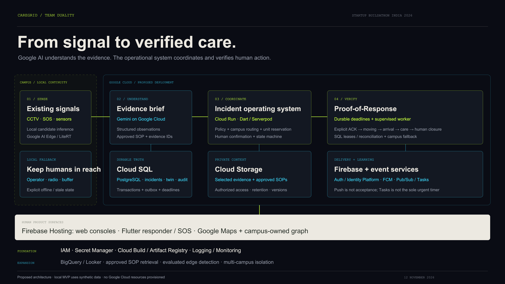
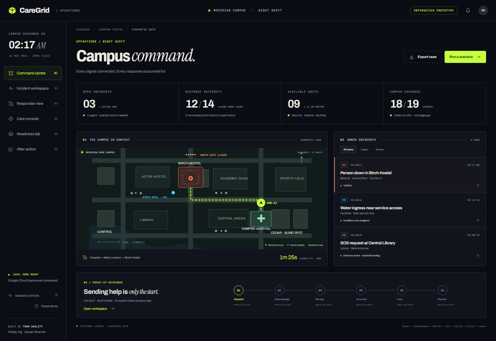

# Pitch visuals · CareGrid / Team Duality

**Finalized UI:** use the [20 November launch gallery](launch/README.md) and [three slide-panel exports](launch/deck/README.md). They match the current blue/butter website and connected console. The older designs below remain historical references.

**New, 20 November:** [connected MVP screenshots and gallery](connected/README.md) show the web workspace using real local Serverpod/PostgreSQL state. Use these for implementation evidence. The original captures below remain the separate presentation experience.

All assets prepared 12 November 2026. [Open the visual gallery](index.html) locally, or use the links below. PNGs can be inserted directly into the organizer's deck; the architecture SVG stays editable and resolution-independent.

## Architecture

- [Architecture overview — editable SVG](architecture-overview.svg)
- [Architecture overview — 3200 × 1800 PNG](architecture-overview.png)

Caption: **Proposed Google Cloud architecture. Local prototype uses synthetic data; Google resources are not yet provisioned.**

## Product screens

| Asset | Use on the deck | Caption / provenance |
| --- | --- | --- |
| [01 — Command centre](01-command-centre.png) | Main product screenshot; owned cases, route and proof chain | Interactive local prototype; fictional campus and seeded incidents |
| [02 — Incident workspace](02-incident-workspace.png) | Evidence, policy context, dispatch and incident memory | Corridor is an original SVG illustration; brief is a fixture, not live Gemini output |
| [03 — Responder](03-responder.png) | Minimal task and next action | Demo state “moving”; no real GPS or crew connection |
| [04 — Care console](04-care-console.png) | Medical handoff and role-minimized view | Synthetic case; actual backend authorization is a pilot implementation gate |
| [05 — Readiness lab](05-readiness-lab.png) | Strong differentiator: rehearse compound failure | Illustrative 401s → 252s what-if example; not a measured field improvement |
| [06 — After-action](06-after-action.png) | MTTC stages and proof completeness | Demo timeline and seed history; not customer results |
| [07 — Mobile responder](07-mobile-responder.png) | Phone view / supporting product image | Narrow 540px browser rendering; synthetic task |
| [08 — Mobile command](08-mobile-command.png) | Responsive overview | Narrow 540px browser rendering; fictional campus |

## Reproduce or change a capture

Start the local prototype with `node caregrid_web/server.mjs`. On Windows with Chrome installed, run `powershell -File scripts/render-pitch-assets.ps1`; use `-MobileOnly` to refresh just narrow captures. Each capture uses its own ignored browser profile under `tmp/`, never the user's personal profile. Fixture queries are documented in [the app README](../../caregrid_web/README.md).

The original presentation screens were rendered with local fonts and visually inspected on 12 November. The connected captures added on 20 November are backed by isolated Chrome interaction tests against the real local API. See [validation record](../../docs/buildathon/VALIDATION.md).

Do not remove the synthetic-data/proposed-integration distinction when using the images. The colors/type follow the supplied Claude Design exports; no original document was rewritten to manufacture a customer, Google integration or pilot outcome.
