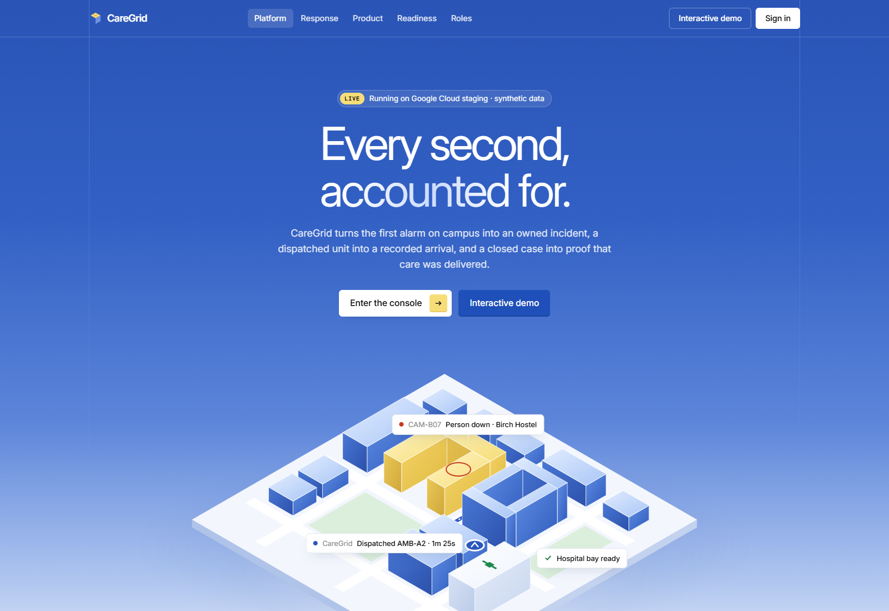
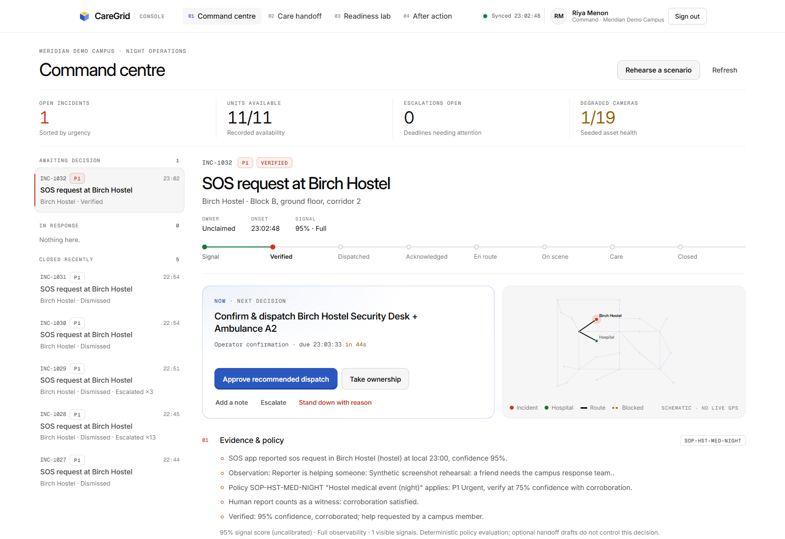
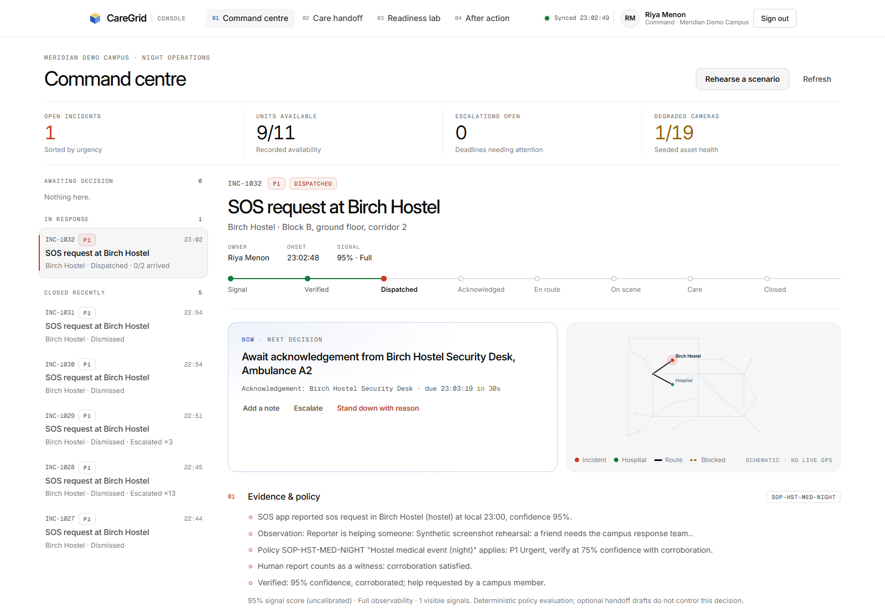
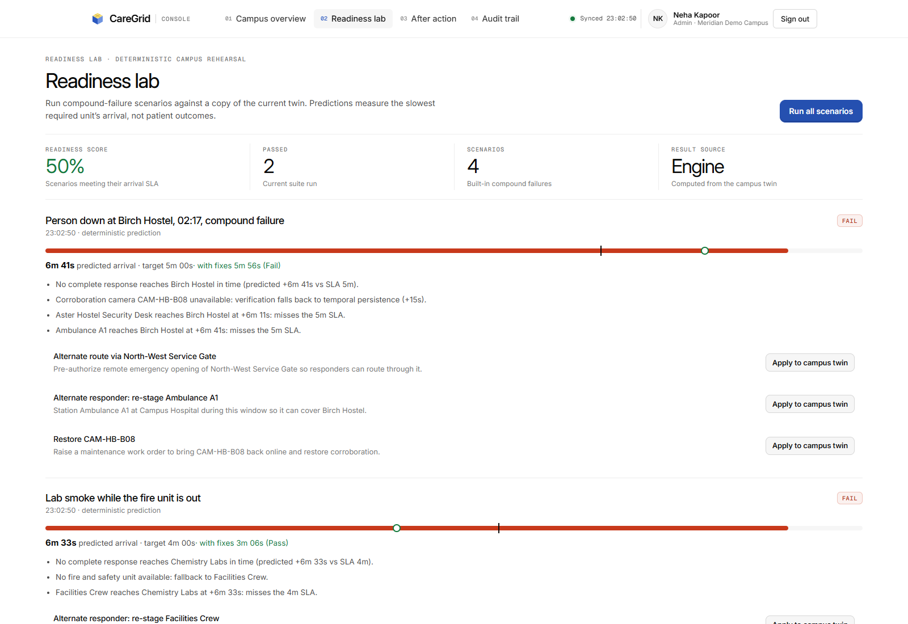
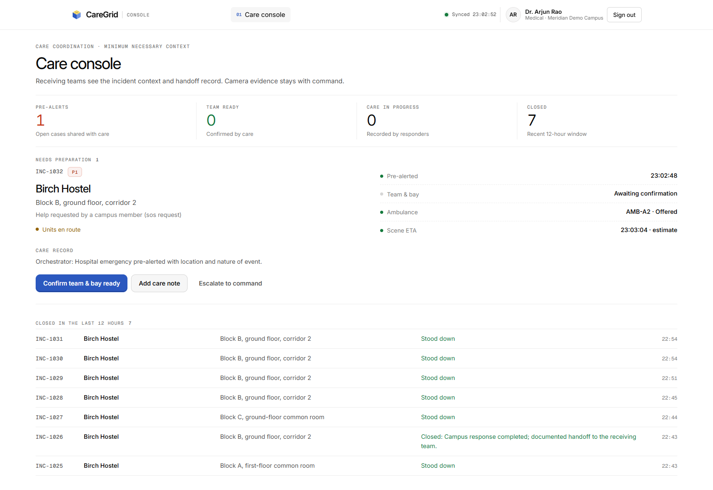
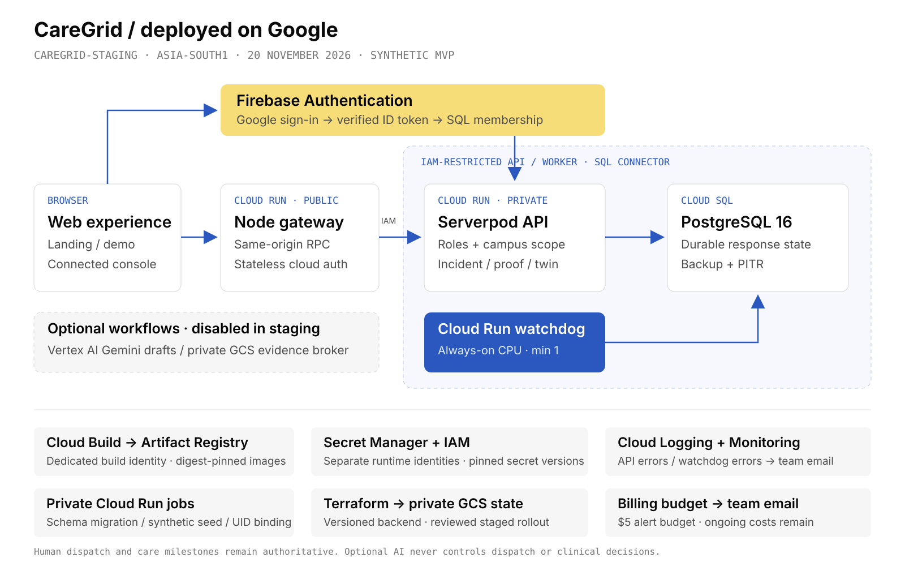

# CareGrid · finalized UI gallery

**20 November 2026 · Team Duality.** These images show the finalized blue/butter editorial UI, introduced in `aa9e40d`. The product captures use real local Serverpod/PostgreSQL state and synthetic PIN identities. They do not establish live Google OAuth, live Gemini output, private GCS acceptance or field performance.

For the exact three-panel pitch slide, use [the deck exports](deck/README.md): **2520 × 2202**, **1020 × 2202**, and **1470 × 2202**. Those files are already framed to the requested proportions.

## Product captures

| Image | Use / provenance |
| --- | --- |
| [01 · Landing page](01-landing.png) | Finalized website; original SVG campus illustration |
| [02 · Command centre](02-command-centre.png) | A real local member SOS, campus policy and recommended two-unit response |
| [03 · Response workspace](03-response-workspace.png) | Human ownership and confirmed dispatch; per-unit proof starts from the real backend record |
| [04 · Readiness lab](04-readiness-lab.png) | Actual deterministic suite output against the local twin; predictions, not patient outcomes |
| [05 · Audit trail](05-audit-trail.png) | Server-written records from synthetic local operator activity |
| [06 · Mobile member](06-mobile-member.png) | Member SOS at a 390 × 844 browser viewport |
| [07 · Mobile responder](07-mobile-responder.png) | Assigned ambulance task at a 390 × 844 browser viewport |
| [08 · Care handoff](08-care-handoff.png) | Role-limited receiving-team context from the same backend |

[Capture manifest](capture-manifest.json) records the time, UI release, mode and viewport dimensions. Suggested slide caption: **Working prototype · fictional campus data.** Keep simulation, prediction and implementation claims distinct.











## Editable artwork

| Visual | Vector | High-resolution export |
| --- | --- | --- |
| CareGrid cover | [SVG](caregrid-cover.svg) | [3200 × 1120 PNG](caregrid-cover.png) |
| Deployed Google architecture | [SVG](google-architecture.svg) | [3200 × 2000 PNG](google-architecture.png) |
| NIET reference map | [SVG](../../../niet_campus_map.svg) | [PNG](../../../niet_campus_map.png) |



The architecture records the live services, supporting Google components and disabled optional workflows. The earlier [architecture overview](../architecture-overview.svg) is the wider proposed design, preserved as a historical reference. Map data © OpenStreetMap contributors, ODbL 1.0; retain the attribution on reused maps.

## Reproduce the product captures

Install the pinned web dependencies, then start a **fresh local synthetic workspace** using the [local launcher](../../../caregrid_web/README.md). In another shell, from the repository root:

```powershell
node scripts/render-launch-assets.mjs
```

The capture script uses an isolated headless Chrome profile and only accepts a loopback origin. It creates a synthetic SOS, records dispatch and runs the readiness suite to show actual connected state. No browser provider response is mocked. Use a fresh workspace so previous rehearsals have not exhausted units or changed the twin. Desktop exports use 1600 × 1100 viewports; mobile exports use 390 × 844. The separate deck exports use the three panel proportions specified in [their provenance note](deck/README.md).

Original dark-design assets and earlier connected screenshots remain in the parent folders; use this gallery for the finalized UI.
