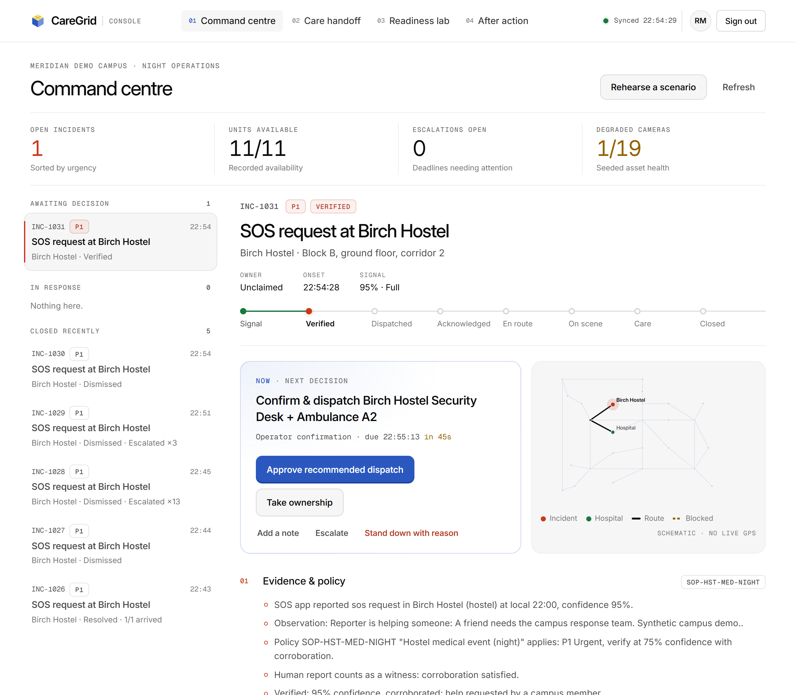
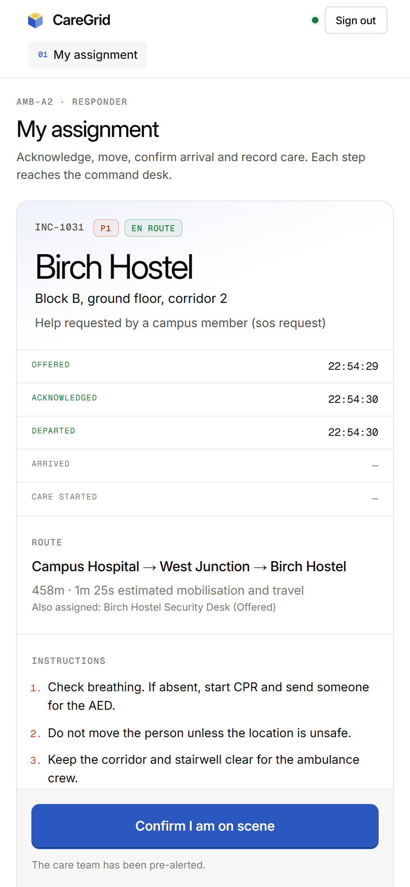
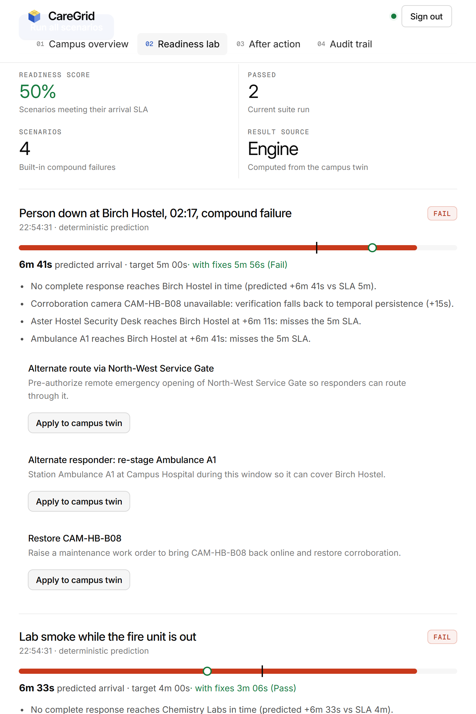

# Pitch slide snapshots · finalized UI

Captured 20 November 2026 from the finalized blue/butter web UI (`aa9e40d`), using a real local Serverpod/PostgreSQL backend. Campus, operators and incident data are fictional. No model, storage or OAuth provider was mocked to create these three screenshots.

The PNGs match the three screenshot-panel proportions in the supplied pitch slide. They share a 2202-pixel height and remain sharp when reduced for a deck. Insert without stretching.

| Panel | Download | Pixels | Caption |
| --- | --- | --- | --- |
| 1 · Command centre | [PNG](01-command-centre.png) | 2520 × 2202 | Case, evidence, campus policy and the recommended two-unit response |
| 2 · Ambulance crew | [PNG](02-ambulance-crew.png) | 1020 × 2202 | One assignment, recorded departure and the next response action |
| 3 · Readiness lab | [PNG](03-readiness-lab.png) | 1470 × 2202 | Rehearsal finds a compound failure and proposes changes to the campus twin |

Suggested slide caption: **Working prototype · fictional campus data.** Readiness values are deterministic predictions, not field measurements or clinical outcomes. The screenshots demonstrate the local connected implementation; they do not establish live Google OAuth acceptance or a real emergency deployment.

