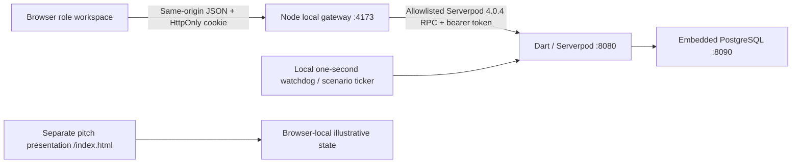

# Connected MVP · updated 20 November 2026

CareGrid now has a web workspace connected to the existing Serverpod application and PostgreSQL database. Command, responder, medical, admin and member accounts share server state. The original pitch presentation remains available separately.

## What works

- A campus member sends an SOS and sees only their own requests and response updates.
- Command reviews the backend policy result and route recommendation, takes ownership, approves dispatch, records notes, escalates or stands down with a reason.
- A separately authenticated responder acknowledges, confirms departure and arrival, records care, and completes their assignment. Each unit has its own timestamps and arrival source.
- Medical staff see pre-alerted cases, confirm receiving-team readiness and add care notes. Knowing another incident's id does not grant access to an unshared case.
- Admin runs the deterministic stress-test suite, reviews recommendations, applies supported fixes, and inspects backend analytics and audit records.
- Explicit scenario runs still support manual or autopilot rehearsal. Their simulated arrival source is labelled `simulation`.
- Connection failures remain visible. Uncertain mutations are not automatically retried. Polling preserves form drafts; responsive screens and accessible labels support keyboard use.

## Correctness fixes

Elapsed time no longer turns a non-simulation dispatch into an arrival. An overdue genuine assignment remains en route and escalates once; an authenticated responder must confirm arrival. Closure also requires a recorded care/action milestone and cannot fill one in retroactively. Admin summary/detail views redact exact location and evidence reasoning; care views omit raw evidence context.

This is still a single-campus prototype. Incident-level progress is the furthest unit, not proof that all required units arrived. The interface therefore shows every unit's record. Transactional allocation, incident revisions, idempotent commands, durable deadlines, tenant isolation and approved closure policies remain pilot gates.

## Local architecture

The gateway uses `POST /endpoint/method` with a named-argument JSON object, verified against the pinned official Serverpod client source and the running backend. It stores backend tokens in memory, exposes an opaque HttpOnly/SameSite=Strict cookie, checks origin/host and a custom request header, limits request bodies and sign-in attempts, and serves an explicit static file surface. Client JavaScript receives neither the bearer token nor the account's stored PIN. Public seeded demo-account PIN hints are intentional in this loopback development mode.

The launcher copies the server into an ignored server-only Dart workspace under `tmp/server-runtime`. It preserves its local database and generated random local database credentials between starts. It uses the root lockfile and needs no Flutter installation. No generated Serverpod protocol/client file is hand-edited.

## Google deployment boundary

No Google project, model, Firebase authentication, Maps API, FCM delivery, cloud database or evidence bucket has been provisioned. This local gateway is not a deployed Google integration. The target remains [Cloud Run + Cloud SQL and the Google services in the architecture](SOLUTION-ARCHITECTURE.md).

Cloud-mode Firebase verification/SQL membership, a stateless Google-authenticated gateway, separate coordinated watchdog runtime and phased Terraform deployment are now implemented and tested offline. The local PIN/session mode remains loopback only. The [optional Gemini draft adapter](GOOGLE-GEMINI.md) is implemented with synthetic response tests and remains disabled by default. Follow [the rollout runbook](../../infra/google/README.md) for actual project/Firebase setup and live verification. SQL transactions/outbox, tenant isolation, telemetry provenance, evaluated model behavior and operational recovery remain pilot gates. No emergency services, real patients or live camera feeds are connected.

## Run, verify and demonstrate

See [the web workspace instructions](../../caregrid_web/README.md). The regression suite includes the real PostgreSQL backend tests, local gateway tests, and isolated Chrome sessions exercising member → command → responder → medical → closure. [Validation](VALIDATION.md) records actual results and limits. [Connected product captures](../../assets/pitch/connected/README.md) use the real local workflow with synthetic data; earlier presentation captures remain labelled illustrative.
