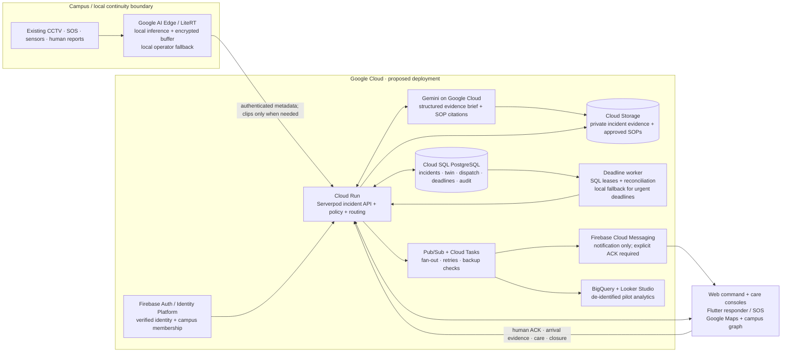

# CareGrid solution architecture

**Team Duality · Hriday Vig + Ishaan Sharma · 12 November 2026**

## 1. Executive architecture decision

CareGrid is an emergency coordination operating system for residential campuses. It turns camera/SOS/sensor reports into owned incidents, uses local context and approved SOPs to propose a response, coordinates human teams, and records whether acknowledgement, arrival and care actually happened. Its product unit is an **incident with an accountable owner**, not a camera alert.

The submission should show three things: **Gemini helps understand evidence**, **the campus graph and policy engine choose feasible actions**, and **Proof-of-Response checks that people follow through**. The Stress-Test Engine rehearses the same response graph under compound failures. This is a stronger story than adding a general chatbot to CCTV.

**Target cloud:** Google-managed runtime, database, identity, AI, evidence storage, messaging and operations. Preserve the existing Dart/Serverpod domain code and PostgreSQL model. Flutter remains appropriate for mobile responders; the new web console provides the submission-quality desktop experience. Open-source code and ordinary cameras/edge hardware are not managed services from another cloud. If organizers prohibit any non-Google-authored library, that exceptional interpretation requires explicit confirmation; Google Cloud hosting does not normally require that.

**Status:** this is a target architecture. The submitted screenshot prototype runs locally with fictional data. No cloud deployment, live vision inference, real responder tracking or Google AI performance is claimed.

## 2. The diagram to put on the deck

Use [the exported diagram](../../assets/pitch/architecture-overview.svg) for the main slide. Show the operational path prominently and support services in a quieter foundation band. Put the extensive catalogue in backup material.



The diagram includes target pilot capabilities, not a claim that all are already deployed. Public frontend hosting is Firebase Hosting; application and AI API services run on Cloud Run. Monitoring, IAM, Secret Manager, Artifact Registry and Cloud Build support the whole cloud boundary.

## 3. Scope and staged deployment

| Stage | Include | Completion evidence |
| --- | --- | --- |
| Submission now | Local interactive console, campus twin, evidence illustration, manual proof chain, missed-ACK scenario, failure rehearsal, architecture and assets | Screens and reproducible demo; clearly labeled synthetic data |
| Cloud buildathon vertical slice | Firebase Hosting, Cloud Run API, Cloud SQL PostgreSQL, Gemini evidence brief, private Storage, Auth, Logging/Monitoring, Secret Manager, Cloud Build/Artifact Registry | One authenticated end-to-end case; actual model output; logs and replayable test evidence |
| Controlled campus pilot | Durable deadlines/outbox, supervised deadline worker, real telemetry, FCM, campus identity/SOPs, local continuity, evaluated edge model, secure evidence review | Drills with trained staff, authorization tests, clock-quality checks, backup restoration, outage rehearsal |
| Expansion | Pub/Sub fan-out, BigQuery/Looker, optional retrieval/voice, stronger perimeter, multi-campus isolation and regional recovery | Measured load, specific integration demand and validated unit economics |

For a two-person team, keep API and domain services as a modular monolith. A small separate Google AI adapter can use an officially supported SDK without replacing the Dart domain. Split ingestion, AI and notification consumers only when load or security boundaries justify it.

## 4. Google AI: substantive, bounded responsibilities

### Evidence understanding

Gemini consumes an authorized incident packet: masked stills/short clips when permitted, structured detector observations, zone/time, known coverage gaps, and the exact approved SOP excerpt/version. It returns a structured operator brief with observable facts, contradictions, missing evidence, cited signal IDs, SOP references and recommended review questions. Voice/SOS intake may later use Google speech/translation capabilities with the original report retained for correction.

Google's [structured output feature](https://docs.cloud.google.com/gemini-enterprise-agent-platform/models/capabilities/control-generated-output) supports constrained JSON schemas. Syntax is not truth. Server validation rejects unknown signal IDs, nonexistent units, mismatched tenant/zone/SOP versions, invented timestamps and diagnostic claims. Model “confidence” is displayed as an uncalibrated assessment if used at all; detector confidence and verification status are separate fields.

```json
{
  "incidentId": "CG-0217",
  "observations": [{"text": "Person remains on the floor", "signalIds": ["sig-1", "sig-2"]}],
  "contradictions": [],
  "missingEvidence": ["No authenticated responder arrival yet"],
  "sopReferences": [{"id": "SOP-HST-MED-NIGHT", "version": "1"}],
  "operatorBrief": "Two independent observations support urgent human review.",
  "requiresHumanReview": true
}
```

This is an example contract, not a captured live Gemini response. The API derives priority, permitted actions and dispatch state independently of model prose.

### Deterministic authority

The existing policy engine chooses severity and verification rules from signed/approved, versioned configuration. The planner uses resource availability and an institution-approved road/gate graph. Gemini can explain a recommendation and identify contradictions; it cannot create a responder, open a gate, dismiss a dispatched emergency, change SOPs or resolve an incident.

Use explicit allowlisted tool contracts if adopting [Google ADK](https://google.github.io/adk-docs/): `readIncident`, `readApprovedSop`, `readCoverage` and `proposeBrief`. Server-side authorization applies to every call. No unrestricted database, arbitrary URL, shell, or direct dispatch tool is exposed to model content. Treat scene text, uploaded SOP text and user reports as data that may contain prompt injection. Human approval gates belong in the domain API, not only in the prompt.

### Retrieval and model lifecycle

Initially retrieve exact SOPs with SQL filters (campus, zone, event family, validity, version). This is more auditable than approximate retrieval for a small policy set. Use Document AI for scanned SOP intake only if needed; an authorized human approves parsed content. Embeddings/pgvector, managed RAG or Vector Search are later options for document discovery. Retrieved documents cannot silently overwrite structured SOP thresholds. Do not use open-web grounding for emergency operating instructions.

Pin the model and prompt version, record schema version and cited evidence, and evaluate before rollout. Keep a bounded model timeout and circuit breaker; on failure show “AI brief unavailable” and continue the manual/deterministic workflow. Do not wait for Gemini before showing an SOS or contacting the operator. Select a current generally available Flash-family model supported in the chosen location; evaluate a larger Google model only for asynchronous after-action analysis if useful. No exact model ID or latency is promised before deployment verification.

Evaluation dataset: recoveries, lying down voluntarily, camera occlusion, low light, mobility aids, different clothing/body types, multiple people, smoke-like artifacts, contradictory reports and injected instructions. Track false negatives, false escalations, abstention, evidence-reference correctness, SOP-citation correctness, prompt-injection failures and p50/p95 latency. Report denominators and conditions; do not translate a demo score into clinical sensitivity.

## 5. End-to-end 02:17 workflow

1. The local gateway receives a candidate event, attaches source ID, observed/received times, device sequence, event UUID and coverage state. It buffers during outages. No facial recognition or default continuous video upload.
2. Authenticated HTTPS ingestion validates the source's campus, schema, replay window, rate and payload size. An idempotency constraint prevents duplicate incident creation.
3. The domain fuses relevant evidence, records negative evidence without erasing history, selects the current night-hostel SOP, and shows an urgent review to the command operator. Independent observations are distinguished from two outputs derived from the same frame.
4. Gemini creates a grounded evidence brief in parallel. Failure/uncertainty is visible. The operator sees original evidence and deterministic policy rationale.
5. The planner computes desk + ambulance options from the campus graph. The operator confirms a permitted plan. A transaction claims available units, writes dispatches, deadlines, timeline and outbox. Concurrent dispatch attempts cannot allocate the same unit twice.
6. An outbox publisher sends notifications with incident ID, dispatch ID and version, not sensitive evidence. FCM is a delivery channel, not proof of acceptance. The app must fetch authorized current state and explicitly acknowledge.
7. A deadline worker checks persisted deadlines. Missing acknowledgement escalates to an accountable operator and selects an approved alternative. A local control-room fallback remains available if the cloud is unreachable.
8. Authenticated responder events advance individual dispatches through acknowledged → moving → arrival → care. GPS accuracy, age and plausible movement are recorded; arrival can also be explicitly checked in by an accountable person under SOP. Estimated arrival alone never proves presence.
9. Medical staff prepare handoff. The system distinguishes security arrival from ambulance arrival and from care start.
10. Authorized human closure requires the configured proof conditions and an outcome note. After-action metrics retain missing stages, manual overrides and clock uncertainty rather than filling gaps with estimates.

## 6. State, transactions and event contracts

**Source of truth:** Cloud SQL PostgreSQL. Keep existing tables and add tenant/campus scope, identities, policy versions, ingestion keys, revision numbers, outbox, deadline jobs and telemetry provenance. Do not introduce a second writable incident truth in Firestore. Optional Firestore projections must be redacted, rebuildable, server-written views with explicit consistency semantics.

Every query and action scopes by authorized campus and role. Role checks and row access are server-side; a frontend role selector is only a demo feature. Use compound foreign keys/constraints or a rigorously tested query layer to prevent cross-campus references. Read access to evidence is audited as well as state changes.

Proposed common event fields:

`eventId, schemaVersion, campusId, incidentId, dispatchId?, producerId, observedAt, receivedAt, sequence, revision, simulation, payload, evidenceRefs, correlationId`.

Business uniqueness uses campus + producer + source-event ID, not a Pub/Sub message ID alone. Accept late evidence into the timeline with explicit lateness; do not silently move state backwards. Commands include `expectedRevision` and an idempotency key. Use a unique active assignment/responder lock and a database transaction for allocation. Outbox publication is retryable; consumer side effects are deduplicated. Pub/Sub push delivery must be treated as at least once ([official delivery qualifications](https://docs.cloud.google.com/pubsub/docs/exactly-once-delivery)).

Persist UTC plus source-clock quality; display Asia/Kolkata using a named timezone. Preserve original observed time and server receive time. Sort controls by consequence, escalation, deadline and onset, with manual override. Include a simulation namespace so synthetic incidents never notify real responders or join real incidents.

## 7. Deadlines, realtime and resilience

The current `OpsTicker` and scenario steps are process-local. Cloud Run request-based CPU and restart behavior make that unsuitable for unattended critical deadlines. For the supervised single-campus cloud demo, one warm instance with instance-based CPU can preserve the current loop temporarily, with `min=1/max=1`, readiness checks and explicit limitations. This is not high availability; deployments can overlap and min instances are not an exclusive-leader mechanism.

For a pilot, move due work into SQL, claim it using expiring leases and fencing tokens, and run a continuously supervised worker. A Cloud Run worker pool or a small Compute Engine service are Google options; verify availability and operational behavior in the chosen location. A reconciler scans overdue deadlines after restart and reports lateness. Do not equate a background process with a hard real-time guarantee. An on-site operator/gateway keeps the urgent escalation path during WAN/cloud failures.

[Cloud Tasks documents duplicate execution and occasional execution delays](https://docs.cloud.google.com/tasks/docs/common-pitfalls). It is appropriate for notification retries, scheduled backup checks, after-action exports and nonurgent reminders. It is not the sole timer enforcing a 30-second responder ACK. Cloud Scheduler can trigger periodic reconciliation but is not a one-second watchdog. Workflows is suitable for administrative/integration sequences, not the incident safety state machine.

[Cloud Run supports WebSockets with bounded requests and best-effort affinity](https://docs.cloud.google.com/run/docs/triggering/websockets). Clients reconnect with jitter and a last-seen revision, then fetch current role-filtered state. Persisted changes are authoritative. A pilot can poll SQL-backed revisions; a scaled fan-out service or optional Memorystore can distribute live updates. Do not assume one instance's Serverpod in-memory channel reaches another instance.

### Failure behavior

| Failure | Expected behavior |
| --- | --- |
| Model timeout / quota / refusal | Manual evidence view and deterministic SOP flow remain usable; report AI unavailable |
| Duplicate/out-of-order event | Deduplicate; revision check; retain late evidence without duplicate dispatch |
| Camera offline / stale frame | Mark observability gap and evidence age; never manufacture camera continuity |
| WAN loss | Local metadata buffer, local operator/radio/phone response, explicit cloud stale banner; replay on recovery |
| FCM silent/drop/stale notification | Dispatch remains offered until explicit current-version ACK; fallback escalation |
| Worker death / deployment overlap | Lease expiry + fencing + overdue reconciliation; monitor worker heartbeat |
| Two incidents need one ambulance | Transactional reservation; alternative plan or commander escalation |
| Road blocked / gate shut | Recompute approved campus route; no autonomous physical gate opening in MVP |
| Telemetry missing / inaccurate / implausible | Keep arrival unverified; allow documented operator/responder check-in per SOP |
| Database unavailable | Read-only/stale indicator; locally documented response process; no fake successful dispatch |
| Backup restore | Restore to isolated environment, reconcile incident revisions/outbox and replay carefully; drill before pilot |
| Quota/billing stop | Alert and local continuity; a cap can interrupt emergency software and requires operational planning |

## 8. Identity, privacy and security

Replace seeded plaintext PINs/public PIN hints with Firebase Authentication. Upgrade to Identity Platform when campus federation, MFA, enterprise identity or tenant features justify it. Verify ID tokens server-side using supported verification or a carefully maintained JWT verifier in Dart; validate issuer/audience/expiry/signature and user/campus assignment ([token verification](https://firebase.google.com/docs/auth/admin/verify-id-tokens)). Do not trust a Google email domain alone as authorization. Device/service identities and human identities are different.

Command sees authorized evidence; medical sees location/handoff without raw camera data; responder sees only the assigned task; admin sees operational configuration with minimized case detail; members see only their SOS. Audit role/tenant changes, evidence grants, emergency access, exports and all incident reads. Any break-glass path needs time-limited permission, reason and later review.

Cloud Storage evidence buckets use uniform bucket-level access and public-access prevention. API-issued short-lived access is purpose/role checked; never put clips in public frontend assets. Retention/deletion follow an institution-approved schedule with documented exceptions and legal holds. Separate raw evidence, thumbnails, approved SOPs, application audit and aggregate analytics. Bucket lifecycle alone does not erase all copies, backups or exported model logs.

Use separate service accounts for API, AI adapter, notification worker and builds; grant only necessary roles/resources. Cloud Run workload identity/ADC avoids service-account JSON keys. Secrets live in Secret Manager. Private Cloud SQL networking/Direct VPC egress or a supported proxy/connector is selected and tested for Dart; do not claim there is an official Dart connector without verifying one. Limit connection pools: `max API instances × per-instance pool + workers + migrations < DB connection budget`.

For the pilot add Cloud Armor/load balancer when exposure/traffic warrants it, API restrictions, rate limits, TLS, schema validation, upload size/type checks, evidence malware handling and dependency/container scanning. Never log tokens, raw medical narratives or identifiable frames by default. Cloud Audit Logs cover cloud administrative access; application audit covers incident reads/actions. A hash chain/append-only export improves tamper detection but is not magical immutability.

Google model [data governance](https://docs.cloud.google.com/gemini-enterprise-agent-platform/resources/zero-data-retention) requires reviewing feature-specific retention. Search/Maps grounding, request-response logging, caching and stored interactions differ. No real medical/personal evidence goes to consumer AI Studio experimentation. [Endpoint documentation](https://docs.cloud.google.com/gemini-enterprise-agent-platform/resources/locations) explicitly warns that endpoint selection alone does not establish residency. Begin with an India region for supported core resources, but validate every model, backup, analytics export and support/processing requirement separately. No compliance certification is implied.

## 9. Observability and measurable outcomes

Use structured Cloud Logging with correlation IDs, Cloud Monitoring dashboards/alerts, uptime checks and traces where supported. Alert on overdue open incidents, oldest unacknowledged dispatch, stale telemetry, watchdog heartbeat, outbox lag, rejected duplicate/unauthorized commands, database saturation, model errors and camera coverage loss. Operational alerts must reach a staffed recipient; a dashboard alone is not escalation.

Product definitions:

- MTTC: onset to first **recorded care start**; report clock uncertainty and missing onsets.
- Arrival: per-unit arrival, measured separately from care.
- RCI: fully verified resolved responses divided by all closed dispatched responses; show numerator/denominator, exclusions and incomplete open cases separately. Do not improve the score by leaving failed cases open indefinitely.
- False escalation: reviewed invalid escalations over reviewed escalations, with adjudication and reporting window. Keep this consistent across deck/UI/API; the old prototype uses a different proxy.
- Readiness: scenario results against explicit assumptions, not a campus safety score or probability of survival.

Initial engineering targets are hypotheses: responsive local console, bounded AI timeout, no silent missed-ACK closure, zero unauthorized cross-role/campus reads in the test suite, and successful restart reconciliation. Only publish numeric service SLOs after measurement. Pilot impact requires baseline drills and comparable intervention drills; no mortality, diagnosis or response-time reduction claim is established here.

## 10. Cost and capacity model

Submission prototype requires no Google billing. For a deployed demo, continuously running SQL and warm CPU can dominate quiet-use costs. Select an explicit demo schedule and deprovision disposable cloud resources after the event; do not weaken a real campus service to save demo costs.

Monthly estimate = runtime CPU/memory + warm-instance time + SQL compute/storage/backups + evidence storage/operations/egress + model input/output/media tokens + notification/event operations + Maps SKUs + logs/metrics + identity usage + network/security components. Use current [Cloud Run prices](https://cloud.google.com/run/pricing), [Cloud SQL prices](https://cloud.google.com/sql/pricing), [AI prices](https://cloud.google.com/vertex-ai/generative-ai/pricing), [Storage prices](https://cloud.google.com/storage/pricing) and [India Maps rules](https://developers.google.com/maps/billing-and-pricing/india) when a project/region/model exists. No unsupported fixed monthly quote is provided.

Planning load, not measured traction: one campus, 20 metadata sources averaging one event/minute is 28,800 events/day; 100 selected AI briefs/day at 2,000 input + 500 output tokens is 6M input + 1.5M output tokens per 30 days before media tokenization. Continuous video is a different and much larger workload. Keep raw video local and bound clip size, model calls and evidence retention.

[Alerts-only budgets](https://docs.cloud.google.com/billing/docs/how-to/budgets) are not caps. Current [per-service spend cap budgets](https://docs.cloud.google.com/billing/docs/how-to/budgets-spend-caps) cover eligible services under specific conditions; they do not stop all fixed costs and are not instantaneous. Use quotas, restricted Maps keys, bounded scaling and alerts as well. In an operational service, plan the continuity consequences before choosing a cap that can pause the runtime.

## 11. Architecture decisions judges can challenge

| Choice | Why | Revisit when |
| --- | --- | --- |
| Cloud SQL over Firestore as primary | Existing relational state, transactions, models and tests; unit reservation and outbox fit SQL | A separately justified offline/realtime projection is needed |
| Modular monolith over microservices | Two founders, one coherent workflow, less deployment/debugging work | Different load/security/release boundaries emerge |
| Deterministic dispatch over unconstrained agent | Reproducible policy, resource and authorization checks | Never transfer final authority solely to model text |
| Local campus graph plus Maps | Private gates/floors/roads need institution truth | Campus graph is surveyed and richer mapping is justified |
| Edge-first selected evidence | Bandwidth, privacy, outage continuity and model-call cost | Explicitly authorized centralized processing has a validated need |
| Tasks as retries/backup | Documented timing and duplicate behavior | Requirements change; never infer a hard guarantee |
| No GKE/Spanner by default | Complexity and cost do not solve current MVP bottlenecks | Verified scale/availability demands require them |
| No FHIR/ABDM integration claim | Product coordinates incidents; clinical record exchange is a distinct integration program | A clinical partner provides a real interoperability requirement |

The comprehensive [Google component catalogue](GOOGLE-COMPONENTS.md) assesses optional services without inflating the MVP. [Implementation plan](IMPLEMENTATION-PLAN.md) maps this design to actual repository changes and acceptance checks.
