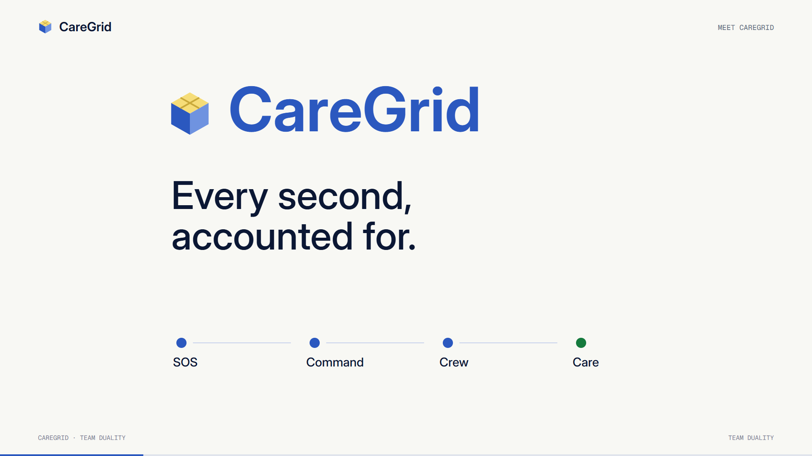

# CareGrid product demo

**Every second, accounted for.** A 2 minute 50 second film by Team Duality, following one request through command, crew and care, then into readiness rehearsal.

**[Watch or download the video](CareGrid-Team-Duality.mp4)**

| File | Purpose |
| --- | --- |
| [MP4](CareGrid-Team-Duality.mp4) | Finished 1920 × 1080, 16:9, 30 fps film; H.264 video and 48 kHz stereo AAC audio |
| [English captions](CareGrid-Team-Duality.srt) | Separate SRT; captions are also burned into the finished video |
| [Poster](CareGrid-poster.png) | Clean 1920 × 1080 title image |
| [Storyboard](CareGrid-storyboard.jpg) | Overview of the film's scenes |
| [Editable project](CareGrid-editable-project.zip) | Composition, narration script, UI captures, voice stems, original score and render tools |
| [Production notes](PRODUCTION-NOTES.md) | Chapters, provenance, sources and prediction boundaries |
| [Export verification](export-verification.json) | Media properties and successful full-file decoding check |
| [SHA-256 checksums](checksums.sha256) | Integrity hashes for the supplied files |

The film uses the finalized CareGrid UI with a real local Serverpod/PostgreSQL backend and fictional campus data. Screen changes are edited captures of authenticated UI actions. Readiness figures are predictions, not measured emergency outcomes.

FFmpeg encodes and assembles the movie, places narration, mixes the original music and checks the export. To edit or render again, extract the source archive and follow its README. Cloud credentials are not included or required to render from the supplied audio.
